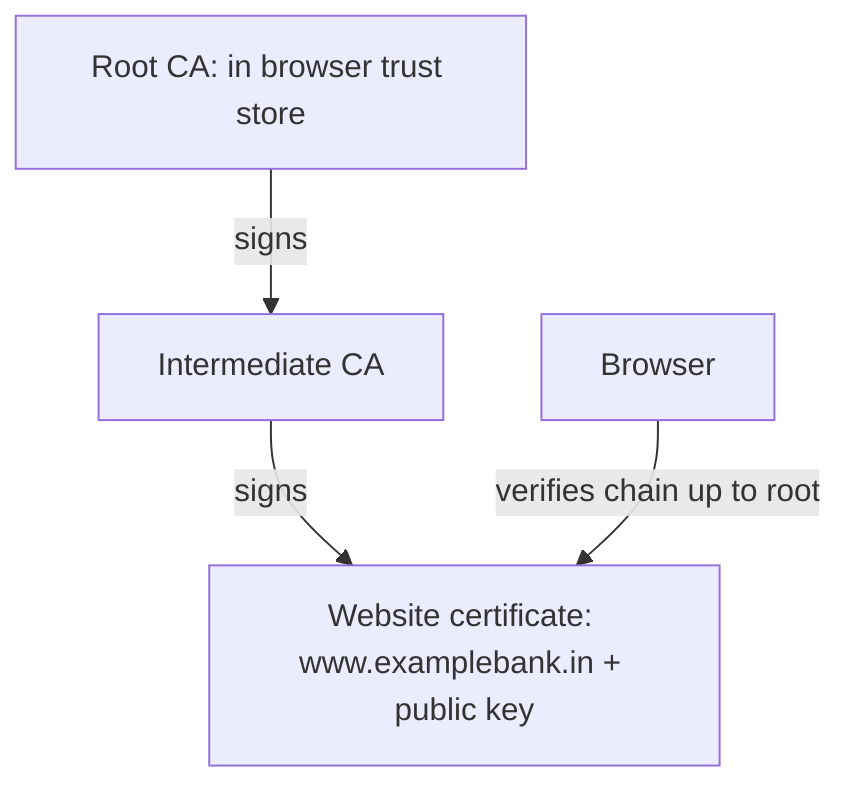

## Why should you care?

Public-key encryption ([[public-key-encryption]]) has one hidden weakness. When your browser receives "the bank's public key", how does it know the key really belongs to the bank?

An attacker on fake Wi-Fi could send you **his own** public key and claim it is the bank's. You would encrypt your password with the attacker's key, he would read it, then pass it on to the real bank. Neither side would notice.

We need a trusted third party that vouches: "this public key belongs to this bank". That system of trusted parties, certificates and rules is the **Public Key Infrastructure**. Every padlock in your browser depends on it.

## In one line

Public Key Infrastructure (PKI) is the system of certificate authorities, digital certificates, policies and procedures that binds public keys to verified identities, so that people and systems can trust whose key they are using.

## Explained

### Q1. What is PKI and why is it needed? ⭐

==PKI is the framework of hardware, software, people, policies and procedures used to create, manage, distribute, verify and revoke digital certificates.==

It solves the **public-key trust problem**:

- ==**Binds a public key to an identity**== (a person, website or device).
- ==**Prevents impersonation:**== an attacker cannot simply claim to be the bank.
- ==**Supports secure services:**== HTTPS, digital signatures, secure email, VPNs, code signing.

### Q2. What is a digital certificate? ⭐

==A digital certificate is an electronic document, signed by a trusted Certificate Authority, that links a public key to the identity of its owner.==

The standard format is **X.509**. A certificate contains:

- ==**Subject:**== who the key belongs to (for example `www.examplebank.in`).
- **Subject's public key.**
- ==**Issuer:**== the CA that signed it.
- ==**Validity period:**== valid-from and valid-to dates.
- ==**Serial number**== and algorithm details.
- ==**CA's digital signature**== over all of the above.

### Q3. What are the components of PKI? ⭐

| Component | Role |
|---|---|
| ==Certificate Authority (CA)== | Issues and signs certificates; the trusted third party |
| ==Registration Authority (RA)== | Verifies the applicant's identity before the CA issues a certificate |
| ==Certificate repository== | Public directory where certificates can be found |
| ==Certificate Revocation List (CRL) / OCSP== | Lists or answers which certificates are cancelled before expiry |
| ==Certificate policy and practice statement== | Rules for how identities are checked and keys protected |
| ==End entities== | Users, servers and devices holding certificates |

### Q4. How is a certificate issued and used?

1. ==**Key pair generated:**== the applicant creates a public–private key pair.
2. ==**Request sent:**== the public key and identity details go to the RA/CA (a Certificate Signing Request).
3. ==**Identity verified**== by the RA (documents, domain ownership, in-person checks).
4. ==**Certificate signed**== by the CA with its private key and returned.
5. ==**Certificate used:**== the owner presents it; others verify the CA's signature, the dates and the revocation status.

### Q5. What is the chain of trust? ⭐

==A chain of trust links a certificate, through one or more intermediate CAs, to a root CA that the verifier already trusts.==

- ==**Root CA:**== top of the chain; its self-signed certificate is pre-installed in browsers and operating systems.
- ==**Intermediate CA:**== signed by the root; issues certificates to websites and users. The root stays offline for safety.
- ==**End-entity certificate:**== the website's or user's certificate.

The browser checks each signature up the chain until it reaches a root in its **trust store**. If any link fails, it shows a security warning.

### Q6. What is certificate revocation, and how does PKI work in India?

**Revocation:** a certificate must be cancelled early if its private key is stolen, the owner leaves, or details change.
- ==**CRL:**== a signed list of revoked serial numbers, published by the CA.
- ==**OCSP:**== an online service that answers "is this certificate still valid?" in real time.

**India:** under the IT Act 2000, the ==**Controller of Certifying Authorities (CCA)**== runs the Root Certifying Authority of India and licenses CAs (such as eMudhra and other licensed providers). Their **Digital Signature Certificates** are used for income-tax, GST and company filings, and Aadhaar-based **eSign** issues short-lived certificates for signing online.

> [!beyond] Beyond the syllabus
> Certificate Transparency logs publicly record every website certificate a CA issues, so wrongly issued certificates can be spotted quickly. Browsers today require it for trusted website certificates.

## Analogy and real-life example

**Analogy: a passport.** You trust a stranger's passport not because you know the person, but because you trust the government that issued it. The passport office (RA) checks documents, the government (CA) issues and stamps it, the passport has an expiry date, and a lost passport is reported and cancelled (revocation). Immigration officers check the stamp against known government seals (root certificates).

**Real example: HTTPS on a bank website.** When you open your bank's site, it sends its certificate. Your browser checks that a trusted CA signed it, that the name matches the address bar, that it has not expired, and that it is not revoked. Only then does it show the padlock and use the bank's public key to set up the encrypted session.

## Diagram

## Key points

> [!important] Key points
> - PKI binds public keys to verified identities using certificates signed by trusted CAs.
> - Digital certificate (X.509): subject, public key, issuer, validity period, serial number, CA signature.
> - Components: CA, RA, repository, CRL/OCSP, policies, end entities.
> - Issuance: key pair → certificate signing request → identity verified → CA signs → certificate used.
> - Chain of trust: end-entity → intermediate CA → root CA in the trust store.
> - Revocation through CRL (published list) or OCSP (online check).
> - India: CCA under the IT Act 2000 licenses CAs; DSCs and Aadhaar eSign are used for official filings.

## Common mistakes

> [!warning] Common mistake
> Thinking the certificate contains the owner's private key. It contains only the **public** key; the private key never leaves the owner.

> [!warning] Common mistake
> Thinking a padlock means the website is honest. It means the connection is encrypted and the domain name was verified; a phishing site can also get a certificate for its own domain.

## Exam questions

**Short answer (2–3 marks)**
1. What is PKI?
2. List the contents of an X.509 digital certificate. ⭐
3. Differentiate between a CA and an RA. ⭐
4. What is a CRL? How is OCSP different?

**Long answer (5 marks)**
1. Explain the components of PKI with a diagram. ⭐
2. Explain the process of certificate issuance and the chain of trust. ⭐
3. Why is PKI needed for public-key cryptography? Explain with the example of HTTPS.

## Sources

- William Stallings, *Cryptography and Network Security*, Pearson, chapter on key management and distribution, X.509 certificates (verify).
- Mark Rhodes-Ousley, *Information Security: The Complete Reference*, 2nd ed., McGraw-Hill, chapter on encryption (verify).
- Controller of Certifying Authorities, Government of India, cca.gov.in.
- RFC 5280, *Internet X.509 Public Key Infrastructure Certificate and Certificate Revocation List (CRL) Profile*.
