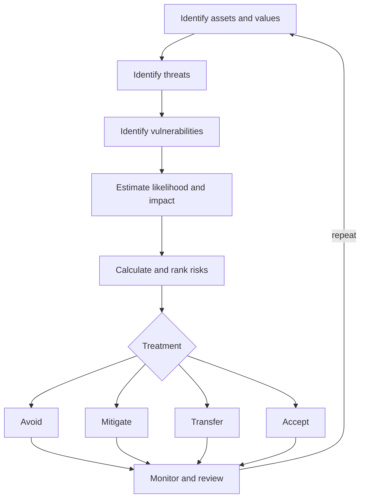

## Why should you care?

Your college has ₹5 lakh for security this year. The list of problems is long: old lab PCs, a website that has never been tested, an ERP with weak passwords, no fire extinguisher in the server room, and staff who click every link.

You cannot fix everything. Which comes first?

Risk analysis answers this. It ranks problems by **how likely** they are and **how much damage** they would do, so the money goes where it reduces the most harm. Without it, organisations fix whatever is loudest or newest, not whatever matters most.

## In one line

Risk analysis is the process of identifying assets, the threats and vulnerabilities that affect them, and the likelihood and impact of each, so that risks can be ranked and treated.

## Explained

### Q1. What is risk?

==Risk is the chance that a threat will exploit a vulnerability, multiplied by the impact if it does.==

$$\text{Risk} = \text{Likelihood} \times \text{Impact}$$

- **High likelihood, low impact:** a lab PC gets adware. Annoying, not serious.
- **Low likelihood, high impact:** the server room floods. Rare, but disastrous.
- **High likelihood, high impact:** a phishing email steals the admin password. Fix first.

Threats and vulnerabilities were defined in [[threats-and-attacks]].

### Q2. What are the steps of risk analysis?

1. **Identify assets** and give each a value (data, servers, services, reputation).
2. **Identify threats** to each asset.
3. **Identify vulnerabilities** the threats could use.
4. **Estimate likelihood** of each threat succeeding.
5. **Estimate impact** on confidentiality, integrity and availability.
6. **Calculate and rank risks.**
7. **Choose a treatment** for each risk and record it in a **risk register**.

The process repeats every year, or whenever systems or threats change.

### Q3. What is qualitative risk analysis?

Qualitative analysis rates likelihood and impact on a **scale** such as Low, Medium, High (or 1 to 5), using expert judgement.

| Likelihood \ Impact | Low | Medium | High |
|---|---|---|---|
| **High** | Medium | High | Critical |
| **Medium** | Low | Medium | High |
| **Low** | Low | Low | Medium |

- **Strength:** quick, needs no exact money figures.
- **Weakness:** subjective; two people may rate the same risk differently.

Most organisations start with this kind of **risk matrix**.

### Q4. What is quantitative risk analysis?

Quantitative analysis puts **money values** on risk.

- **AV** (Asset Value): value of the asset in rupees.
- **EF** (Exposure Factor): fraction of the value lost in one incident (0 to 1).
- **SLE** (Single Loss Expectancy) $= AV \times EF$
- **ARO** (Annualised Rate of Occurrence): expected incidents per year.
- **ALE** (Annualised Loss Expectancy) $= SLE \times ARO$

==SLE = AV × EF, and ALE = SLE × ARO.==

- **Strength:** objective numbers that management understands; supports cost–benefit decisions ([[justifying-security-investment]]).
- **Weakness:** good data on probabilities is often unavailable.

### Q5. Worked example (quantitative)

A college's admission database server is valued at ₹20,00,000 (including data and downtime). A ransomware attack would destroy 30% of its value. Such an attack is expected once every 5 years.

- AV = ₹20,00,000, EF = 0.30
- SLE = 20,00,000 × 0.30 = **₹6,00,000**
- ARO = 1/5 = 0.2
- ALE = 6,00,000 × 0.2 = **₹1,20,000 per year**

So spending up to about ₹1,20,000 a year on controls that remove this risk can be justified. A control costing ₹3,00,000 a year would not be.

### Q6. How are risks treated?

After ranking, each risk gets one of four treatments:

| Treatment | Meaning | Example |
|---|---|---|
| Avoid | Stop the risky activity | Do not store card numbers at all |
| Mitigate (reduce) | Add controls to lower likelihood or impact | Patch servers, add backups |
| Transfer (share) | Shift the financial impact to another party | Cyber-insurance, outsourcing to a provider |
| Accept | Live with it, knowingly | A low risk where controls would cost more than the loss |

==Risk treatments: avoid, mitigate, transfer, accept.==

The risk left after treatment is called **residual risk**. Management must formally accept it.

> [!beyond] Beyond the syllabus
> Organisations often follow published methods such as NIST SP 800-30 or ISO/IEC 27005 for risk assessment, so that results are consistent from year to year and can be audited.

## Analogy and real-life example

**Analogy: travelling by train.** Before a long trip you think: theft of luggage (likely, medium loss), missing the train (possible, small loss), an accident (rare, huge loss). You chain your bag (mitigate), leave early (avoid), buy travel insurance (transfer), and accept that the train may run late (accept). That is risk analysis without the formulas.

**Real example: banks.** Indian banks keep risk registers for cyber threats as part of their cyber security framework. A risk such as "phishing of customers" is rated high, so they spend on SMS warnings, transaction limits for new payees and fraud monitoring, while low risks are accepted and reviewed each year.

## Diagram

## Key points

> [!important] Key points
> - Risk = likelihood × impact.
> - Steps: identify assets → threats → vulnerabilities → estimate likelihood and impact → rank risks → treat → review.
> - Qualitative analysis: rating scales and a risk matrix; quick but subjective.
> - Quantitative analysis: SLE = AV × EF; ALE = SLE × ARO; objective but needs data.
> - Treatments: avoid, mitigate, transfer, accept.
> - Residual risk is what remains after treatment; management must accept it.
> - Risks are recorded in a risk register and reviewed regularly.

## Common mistakes

> [!warning] Common mistake
> Writing ALE = AV × ARO. The exposure factor is missing: first find the loss in one incident (SLE = AV × EF), then multiply by ARO.

> [!warning] Common mistake
> Thinking risk can be reduced to zero. Every treatment leaves some residual risk; the goal is to bring risk down to a level management accepts.

## Exam questions

**Short answer (2–3 marks)**
1. Define risk. How is it calculated?
2. Differentiate between qualitative and quantitative risk analysis.
3. What is residual risk?
4. Define AV, EF, SLE, ARO and ALE.

**Long answer (5 marks)**
1. Explain the steps of risk analysis with a diagram.
2. Explain the four ways of treating risk, with an example of each.
3. A web server is worth ₹12,00,000. A DDoS attack causes a 25% loss of its value and is expected 2 times a year. Calculate SLE and ALE. Would a ₹4,00,000 per year anti-DDoS service be justified?

## Sources

- Mark Rhodes-Ousley, *Information Security: The Complete Reference*, 2nd ed., McGraw-Hill, Ch. 2, "Risk Analysis" (verify).
- Charles P. Pfleeger, Shari L. Pfleeger and Jonathan Margulies, *Security in Computing*, 5th ed., Pearson, section on risk analysis (verify).
- NIST Special Publication 800-30 Revision 1, *Guide for Conducting Risk Assessments*.
