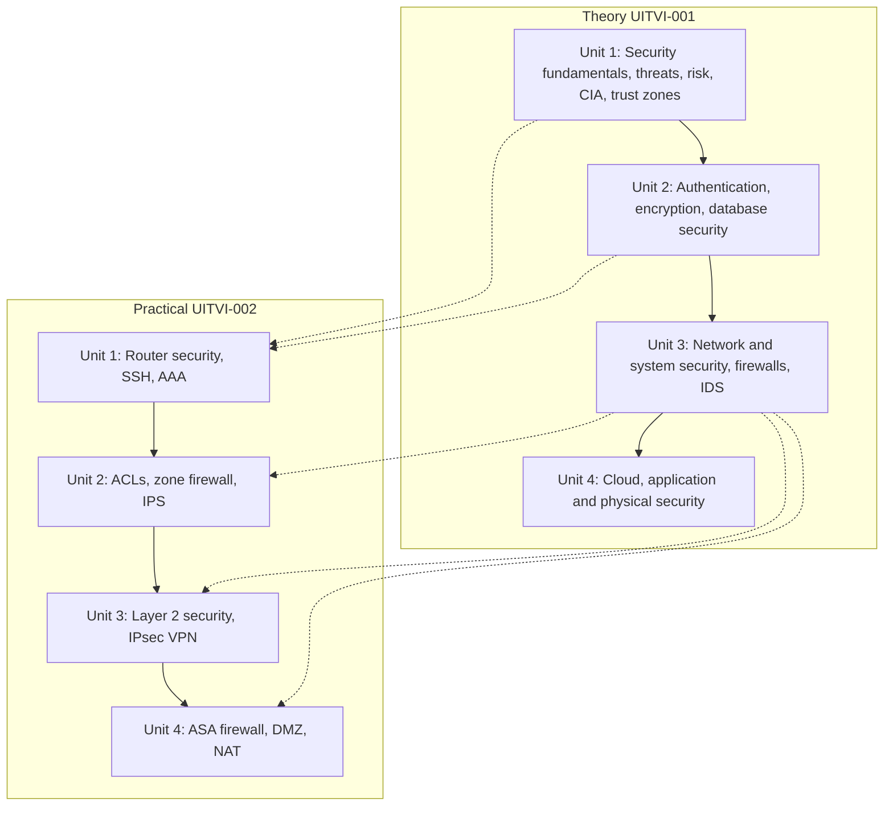

## Why this subject matters

Think of one ordinary day. You pay for chai with UPI, check marks on the college portal, download a hall ticket from DigiLocker and book a Tatkal ticket on IRCTC. Every one of these runs on computers that someone, somewhere, is trying to break into.

If the attacker wins, money moves to the wrong account, marks change, a ticket goes to a bot, or a hospital cannot see a patient's report.

==Security in computing is the work of keeping information and systems safe, correct and available, even when someone is actively trying to misuse them.==

This subject teaches you how that work is planned, built and checked.

## A short story

On the morning of 23 November 2022, staff at AIIMS New Delhi, India's best-known public hospital, found their e-Hospital servers down. Files had been encrypted by ransomware.

- Registration, billing, lab reports and appointments all stopped.
- Doctors and clerks went back to paper. The hospital ran in manual mode for more than a week while thousands of computers were cleaned one by one.
- What saved the data: a few secondary servers holding a copy of the database were not infected, and were disconnected from the network immediately.

Notice what happened. One weakness stopped a hospital. One good habit, a separate backup, brought it back. That is this whole subject in one story.

## Where it is used today

- **Banking and payments:** UPI apps, net banking, card networks, fraud detection.
- **Government services:** Aadhaar authentication, DigiLocker, income-tax and GST portals. CERT-In (India's national incident response team) handles attacks on them.
- **Hospitals:** patient records, lab systems, connected medical devices.
- **Companies of every size:** office networks, email, cloud servers, customer databases.
- **Telecom and ISPs:** routers, switches and firewalls that carry everyone's traffic. This is exactly what your practicals configure.
- **Your own phone:** screen locks, app permissions, OTPs, encrypted chats.

## What you will be able to do

By the end of this course you will be able to:

- Explain why an organisation needs security, what threats it faces, and how to rank risks.
- Describe how passwords, encryption and certificates protect data, and how databases are secured.
- Design a network with firewalls, trust zones, intrusion detection and secure wireless.
- Explain how applications, cloud systems and even buildings are protected.
- **In the lab:** configure real Cisco security features in Packet Tracer: authenticated routing, SSH, AAA, ACLs, zone-based firewalls, IPS, VLAN and port security, IPsec VPNs and the ASA firewall.

## Careers that use it

| Role | What they do |
|---|---|
| SOC analyst | Watches alerts in a Security Operations Centre and responds to attacks |
| Network security engineer | Configures firewalls, VPNs and secure routers (your practicals) |
| Penetration tester | Attacks systems legally to find weaknesses before criminals do |
| Security auditor / GRC analyst | Checks that an organisation follows policies and laws such as the DPDP Act |
| Cloud security engineer | Secures servers and data on AWS, Azure or Google Cloud |
| Application security engineer | Finds and fixes security bugs in software |

Certifications students often start with: CompTIA Security+, Cisco CCNA, then CEH or Cisco CyberOps.

## Map of the subject

Unit 1 gives the vocabulary for everything else. Units 2 and 3 are where the theory and the lab meet most closely.

## Sources

- Charles P. Pfleeger, Shari L. Pfleeger and Jonathan Margulies, *Security in Computing*, 5th ed., Pearson, Ch. 1 (verify).
- Mark Rhodes-Ousley, *Information Security: The Complete Reference*, 2nd ed., McGraw-Hill, Ch. 1 (verify).
- University syllabus, UITVI-001 (theory) and UITVI-002 (practical), BOS dated 05/06/2026.
- News reports on the AIIMS New Delhi ransomware attack, November 2022 (IANS, Business Today, Healthcare IT News).
