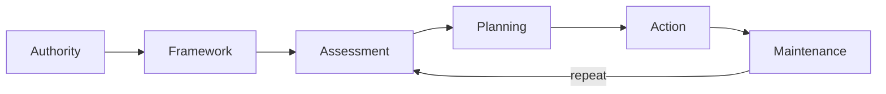

## Why should you care?

A college buys a new firewall and antivirus for every lab PC. Six months later:

- a teacher who left in May can still log in to the ERP and see marks,
- the result sheet is emailed to a personal Gmail "to finish work at home",
- nobody knows whether last month's backup actually works.

The money went into tools. Nobody decided **who approves access, who removes it, or who checks backups**. These are not technical failures; they are failures of method.

A security methodology is the plan that makes tools useful: what to protect, in what order, who is responsible, and how you know it is working.

## In one line

A security methodology is a planned, repeatable way of protecting an organisation, carried out as a security program that combines business processes and technical controls and keeps improving.

## Explained

### Q1. What is a security methodology?

==A security methodology is a structured, repeatable approach to identifying what must be protected, choosing controls, putting them in place, and checking that they work.==

It answers four questions in order:

1. ==**What** are we protecting?== (information assets)
2. ==**From what?** (threats and risks)==
3. ==**How?** (controls: process and technology)==
4. ==**Is it working?** (monitoring, audit, improvement)==

Without a methodology, security becomes a shopping list of products bought after each scare.

### Q2. What does a security methodology involve?

Security rests on three things working together:

| Part | Meaning | College example |
|---|---|---|
| People | ==Awareness, skills, responsibility== | Staff trained not to share ERP passwords |
| Process | ==Rules for how work is done== | Access approved by HOD, removed on the last working day |
| Technology | ==Tools that enforce and monitor== | Firewall, ERP logins, encrypted backups |

==Security fails at its weakest link, and that link is most often people or process, not technology.==

### Q3. What is a security program?

==A **security program** is the methodology put into practice in one organisation==: a continuing set of activities, roles and documents, owned by management.

It is a **program**, not a **project**: ==a project ends; a program never does==, because threats, staff and systems keep changing.

A typical program has:

- ==a person in charge== (for example a CISO, Chief Information Security Officer),
- ==written policies approved by management==,
- ==a budget and a yearly plan==,
- ==regular reviews, audits and training==.

### Q4. How is a security program built? (steps 1–3)

1. ==**Authority:** top management formally backs the program==, appoints its owner and gives a budget. Without this, nobody follows the rules.
2. ==**Framework:** write the rules down==, from general to specific:
   - ==**Policy:** what must be achieved== ("All student data is confidential").
   - ==**Standard:** the required way== ("Passwords of at least 12 characters").
   - ==**Procedure:** the step-by-step how== ("Steps to create an ERP account").
   - **Guideline:** recommended, not mandatory, advice.
3. ==**Assessment:** list the assets, find threats== and weaknesses, and rank risks ([[risk-analysis]], lecture 5).

### Q5. How is a security program built? (steps 4–6)

4. ==**Planning:** decide which risks to fix first==, with what controls, by when and at what cost.
5. ==**Action:** implement the controls==: configure systems, change processes, train people.
6. ==**Maintenance:** monitor, audit, respond to incidents==, and repeat the cycle as things change.

==Steps of a security program: Authority, Framework, Assessment, Planning, Action, Maintenance.==

The same idea appears in the ISO 27001 standard as ==**Plan–Do–Check–Act**==: plan the controls, do (implement) them, check that they work, act to improve.

### Q6. What is the difference between business processes and technical controls?

| | Business processes (administrative controls) | Technical controls |
|---|---|---|
| What | ==Rules for how people work== | ==Hardware and software that enforce rules== |
| Examples | Access approval, joining/leaving checklist, maker–checker in banks, background checks | Passwords, firewalls, encryption, audit logs |
| Who runs them | Managers and staff | Systems, set up by IT |
| Weakness | Depends on people following them | Only enforces what someone configured |

==They depend on each other.== The ERP can disable a login automatically (technical), but only if HR tells IT that the teacher has left (process).

### Q7. How else are controls classified?

By **when** they act:

- ==**Preventive:** stop an incident== (firewall rule, locked door, maker–checker approval).
- ==**Detective:** notice an incident== (CCTV, audit logs, intrusion detection).
- ==**Corrective:** recover after it== (restore from backup, patch, incident response).

By **type**: ==administrative (process), technical (logical) and physical== (guards, locks).

A good program has some of each. The AIIMS ransomware attack in 2022 showed a gap in prevention, while separate backup servers made correction possible.

> [!beyond] Beyond the syllabus
> In industry, organisations prove their program to customers through certification (ISO/IEC 27001) or audits (SOC 2). Indian banks follow RBI's cyber security framework, and government bodies follow CERT-In directions, such as reporting certain incidents within 6 hours.

## Analogy and real-life example

**Analogy: a cricket team's preparation.** Buying the best bats (technology) does not win matches. A team needs a captain and selectors (authority), a game plan (framework), a study of the opponent (assessment), a batting order (planning), the match itself (action), and a review of the video afterwards (maintenance). Then it does it all again for the next series.

**Real example: maker–checker in Indian banks.** When a bank clerk (maker) enters a large fund transfer, a second officer (checker) must approve it before it goes through. The rule is a business process; the core banking software enforces it as a technical control. Neither alone stops a dishonest or careless clerk.

## Diagram

## Key points

> [!important] Key points
> - Security methodology: a structured, repeatable approach to decide what to protect, choose controls, implement them and check them.
> - Security depends on people, process and technology; the weakest link is usually people or process.
> - A security program is ongoing (a program, not a project) and owned by management.
> - Steps: Authority, Framework, Assessment, Planning, Action, Maintenance (repeat). ISO 27001 calls the cycle Plan–Do–Check–Act.
> - Framework documents: policy (what), standard (required how), procedure (steps), guideline (advice).
> - Business processes (administrative controls) decide the rules; technical controls enforce them. Each needs the other.
> - Controls by function: preventive, detective, corrective. By type: administrative, technical, physical.

## Common mistakes

> [!warning] Common mistake
> Treating security as a one-time project that ends when the firewall is installed. Without maintenance, rules and systems drift out of date within months.

> [!warning] Common mistake
> Mixing up policy and procedure. A policy says what must happen and why; a procedure gives the exact steps. Policies change rarely; procedures change whenever the system changes.

## Exam questions

**Short answer (2–3 marks)**
1. What is a security methodology?
2. Differentiate between a security program and a security project.
3. Distinguish between policy, standard, procedure and guideline.
4. Give one example each of preventive, detective and corrective controls.

**Long answer (5 marks)**
1. Explain the steps involved in building a security program.
2. Compare business processes and technical controls, with examples. Why are both needed?
3. "Security is about people, process and technology." Explain with a suitable example.

## Sources

- Mark Rhodes-Ousley, *Information Security: The Complete Reference*, 2nd ed., McGraw-Hill, Ch. 1, sections on security methodology and building a security program (verify).
- Charles P. Pfleeger, Shari L. Pfleeger and Jonathan Margulies, *Security in Computing*, 5th ed., Pearson, Ch. 1, controls (verify).
- ISO/IEC 27001:2022, *Information security management systems: Requirements*.
