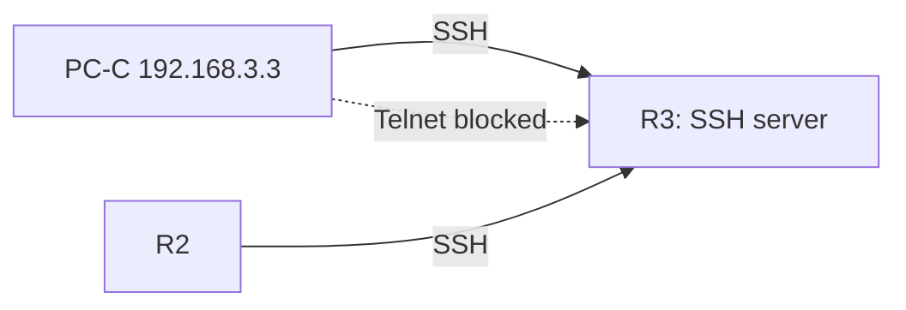

## Aim

To configure SSH version 2 on a Cisco router so that administrators can manage it remotely over an encrypted connection, and to disable insecure Telnet access.

## Concepts used

- [[network-defense-best-practices]]: harden devices; use SSH instead of Telnet.
- [[cia-triad]]: SSH protects the confidentiality of admin passwords and commands.
- [[authentication]]: local usernames and passwords (Unit 2 theory).

**Why this matters.** Telnet sends everything, including the admin password, as plain text. Anyone who can capture traffic on the path (a compromised PC, a mirrored switch port, fake Wi-Fi) can read the password and take over the router. SSH encrypts the whole session, so a captured packet shows only scrambled data.

## Setup

**Tool:** Cisco Packet Tracer (8.x or later).

### Devices and topology

Open your saved file from Practical 2. The topology is unchanged: R1–R2–R3 with OSPF MD5 authentication, PC-A and the NTP/syslog server on R1's LAN, and PC-C on R3's LAN.

SSH is configured on **R3**. You will test it from **PC-C** (on R3's LAN) and from **R2** (a remote router).



### Credentials used

| Item | Value |
|---|---|
| Domain name | ccnasecurity.com |
| Local user | SSHadmin |
| Password | ciscosshpa55 |
| Enable secret | ciscoenpa55 |

## Code

### Step 1. Check that Telnet works before you secure it

```text
R3(config)# enable secret ciscoenpa55
R3(config)# line vty 0 4
R3(config-line)# password ciscovtypa55
R3(config-line)# login
R3(config-line)# end
```

From PC-C (Desktop → Command Prompt): `telnet 192.168.3.1`. You log in with `ciscovtypa55`. This works, but the password crossed the network in plain text.

### Step 2. Domain name, local user and RSA keys

```text
R3# configure terminal
R3(config)# ip domain-name ccnasecurity.com
R3(config)# username SSHadmin secret ciscosshpa55
R3(config)# crypto key generate rsa
How many bits in the modulus [512]: 1024
```

### Step 3. SSH settings and VTY lines

```text
R3(config)# ip ssh version 2
R3(config)# ip ssh time-out 90
R3(config)# ip ssh authentication-retries 2
R3(config)# line vty 0 4
R3(config-line)# login local
R3(config-line)# transport input ssh
R3(config-line)# end
```

### Step 4. Verify

```text
R3# show ip ssh
PC-C> telnet 192.168.3.1
PC-C> ssh -l SSHadmin 192.168.3.1
R2# ssh -v 2 -l SSHadmin 10.2.2.1
```

## Output

> [!warning] Replace with your own output
> The blocks below show what correct output looks like. After running the lab, paste your real output here, or save a screenshot in `content/assets/img/security-in-computing/` and link it with alt text.

**SSH is enabled with the new settings** (`show ip ssh` on R3):

```output
SSH Enabled - version 2.0
Authentication timeout: 90 secs; Authentication retries: 2
```

**Telnet is now refused** (PC-C):

```output
C:\>telnet 192.168.3.1
Trying 192.168.3.1 ...
% Connection refused by remote host
```

**SSH login works** (PC-C):

```output
C:\>ssh -l SSHadmin 192.168.3.1

Password:

R3>
```

The same login works from R2 using `ssh -v 2 -l SSHadmin 10.2.2.1`.

## Explanation

### Why SSH needs a domain name and RSA keys

- `ip domain-name ccnasecurity.com`: the router names its RSA key pair using hostname + domain (here `R3.ccnasecurity.com`). Without a domain name, key generation fails.
- `crypto key generate rsa` with **1024** bits: creates the public/private key pair SSH uses to set up the encrypted session. ==SSH version 2 needs a key of at least 768 bits.==
- `username SSHadmin secret ciscosshpa55`: a local account. `secret` stores the password as a hash, not plain text.

### What the SSH and VTY commands do

- `ip ssh version 2`: use only SSHv2; version 1 has known weaknesses.
- `ip ssh time-out 90`: close an idle login attempt after 90 seconds.
- `ip ssh authentication-retries 2`: drop the connection after 2 failed password attempts, which slows down password guessing.
- `login local`: check the username and password against the local user database.
- `transport input ssh`: ==allow only SSH on the remote-access lines; Telnet is refused.==

### Telnet versus SSH

| Point | Telnet | SSH |
|---|---|---|
| Port | TCP 23 | TCP 22 |
| Data on the wire | Plain text | Encrypted |
| Login | Line password | Username and password (or keys) |
| Use today | Never on production networks | Standard for remote management |

> [!beyond] Beyond the syllabus
> Real routers use RSA keys of 2048 bits or more, or newer key types, and often allow SSH only from a management network using an ACL on the VTY lines (you do this in Practical 6).

## Try it

1. From PC-C, try SSH with a wrong password twice. What happens after the second failure? Which command controls this?
2. On R3, run `line vty 0 4` then `transport input telnet ssh`. Can PC-C Telnet in again? Why is this a bad idea? Change it back to `transport input ssh`.

## Viva questions

1. Why is Telnet insecure? *It sends everything, including passwords, in plain text.*
2. Which port does SSH use? *TCP port 22 (Telnet uses TCP 23).*
3. Why must a domain name be set before generating RSA keys? *The key pair is named using the hostname and domain name.*
4. What is the minimum RSA key size for SSH version 2? *768 bits; 1024 or more is used in practice.*
5. What does `transport input ssh` do? *It allows only SSH connections on the VTY lines, blocking Telnet.*
6. What is the difference between `login` and `login local`? *`login` uses the line password; `login local` uses usernames and passwords from the local database.*
7. Why use `username … secret` instead of `username … password`? *`secret` stores a hash of the password; `password` stores it in plain text or weak reversible form.*

## Sources

- Cisco, *Secure Shell Configuration Guide* for IOS (verify exact title for your IOS version).
- Cisco Networking Academy, CCNA Security Packet Tracer activity on syslog, NTP and SSH operations (verify).
- RFC 4251, *The Secure Shell (SSH) Protocol Architecture*.
