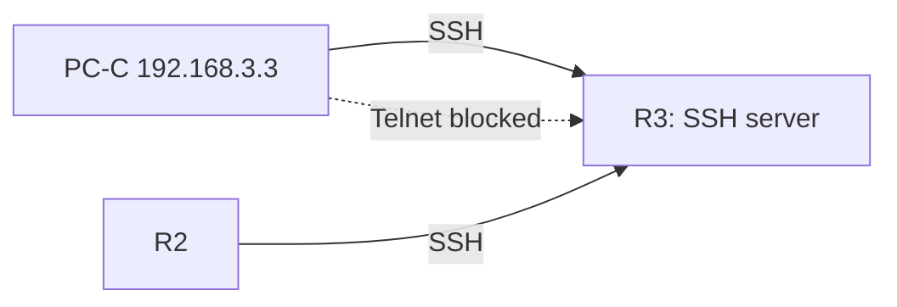

## Aim

To configure SSH version 2 on a Cisco router so that administrators can manage it remotely over an encrypted connection, and to disable insecure Telnet access.

## Concepts used

- [[network-defense-best-practices]]: harden devices; use SSH instead of Telnet.
- [[cia-triad]]: SSH protects the confidentiality of admin passwords and commands.
- [[authentication]]: local usernames and passwords (Unit 2 theory).

**Why this matters.** Telnet sends everything, including the admin password, as plain text. Anyone who can capture traffic on the path (a compromised PC, a mirrored switch port, fake Wi-Fi) can read the password and take over the router. SSH encrypts the whole session, so a captured packet shows only scrambled data.

## Before the lab

**Install or open**
- Cisco Packet Tracer 8.x or later.
- Your saved file **practical2.pkt** (Practicals 1 and 2 working).

**Revise first**
- [[symmetric-encryption]] and [[public-key-encryption]] in outline: SSH uses a public/private key pair to set up an encrypted session.
- The difference between a **line password** (one shared password) and a **username + password** (one per person).
- Ports: Telnet is **TCP 23**, SSH is **TCP 22**.

## Setup

**Tool:** Cisco Packet Tracer (8.x or later).

### Devices and topology

The topology from Practical 2, unchanged. SSH is configured on **R3**. You will test it from **PC-C** (on R3's LAN) and from **R2** (a remote router).



### Credentials used

| Item | Value |
|---|---|
| Domain name | ccnasecurity.com |
| Local user | SSHadmin |
| Password | ciscosshpa55 |
| Enable secret | ciscoenpa55 |
| Old VTY line password (Telnet test only) | ciscovtypa55 |

## Steps

### Part A. See why Telnet is unsafe

1. **Open your Practical 2 file and save a copy** as `practical3.pkt`.
   → **You should see:** the topology with the NTP/syslog server, all links green.
2. **Set an enable secret and a Telnet line password on R3.**
   ```text
   configure terminal
   enable secret ciscoenpa55
   line vty 0 4
    password ciscovtypa55
    login
   end
   ```
   → **You should see:** the prompt return to `R3#`, no error.
3. **Telnet to R3 from PC-C.** PC-C → Desktop → Command Prompt → `telnet 192.168.3.1`. Enter the password `ciscovtypa55`.
   → **You should see:** `Trying 192.168.3.1 ...Open`, then `User Access Verification`, `Password:`, and finally `R3>`. Type `exit`; you see `[Connection to 192.168.3.1 closed by foreign host]`. It works, but the password crossed the network as plain text.

### Part B. Prepare R3 for SSH

4. **Set a domain name on R3.**
   ```text
   configure terminal
   ip domain-name ccnasecurity.com
   ```
   → **You should see:** no message.
5. **Create a local user.**
   ```text
   username SSHadmin secret ciscosshpa55
   ```
   → **You should see:** no message.
6. **Generate the RSA key pair.**
   ```text
   crypto key generate rsa
   ```
   When asked `How many bits in the modulus [512]:`, type `1024` and press Enter.
   → **You should see:** `The name for the keys will be: R3.ccnasecurity.com`, then `% Generating 1024 bit RSA keys, keys will be non-exportable...[OK]`, then `%SSH-5-ENABLED: SSH 1.99 has been enabled`.

### Part C. Configure SSH and lock the VTY lines

7. **Set SSH version 2, a timeout and a retry limit.**
   ```text
   ip ssh version 2
   ip ssh time-out 90
   ip ssh authentication-retries 2
   ```
   → **You should see:** no error.
8. **Make the VTY lines use local users and allow only SSH.**
   ```text
   line vty 0 4
    login local
    transport input ssh
   end
   ```
   → **You should see:** the prompt return to `R3#`.
9. **Check the SSH settings.** On R3: `show ip ssh`.
   → **You should see:** `SSH Enabled - version 2.0` and `Authentication timeout: 90 secs; Authentication retries: 2`.

### Part D. Test

10. **Try Telnet again from PC-C.** `telnet 192.168.3.1`
    → **You should see:** `% Connection refused by remote host`. Telnet is now blocked.
11. **Connect with SSH from PC-C.** `ssh -l SSHadmin 192.168.3.1` (the option is a lowercase L). Enter `ciscosshpa55`.
    → **You should see:** `Password:`, then the prompt `R3>`. Type `enable` and the secret `ciscoenpa55` to reach `R3#`, then `exit`.
12. **Connect with SSH from R2.** On R2: `ssh -v 2 -l SSHadmin 10.2.2.1`.
    → **You should see:** `Password:`, then `R3>`. Type `exit` to return to R2.
13. **Save everything.** `copy running-config startup-config` on R3; File → Save.
    → **You should see:** `Building configuration... [OK]`.

## Code

Complete configuration added on **R3** in this practical:

```text
enable secret ciscoenpa55
ip domain-name ccnasecurity.com
username SSHadmin secret ciscosshpa55
crypto key generate rsa
! (answer 1024 at the modulus prompt)
ip ssh version 2
ip ssh time-out 90
ip ssh authentication-retries 2
line vty 0 4
 password ciscovtypa55
 login local
 transport input ssh
```

## Output

> [!warning] Replace with your own output
> The blocks below show what correct output looks like. After running the lab, paste your real output here, or save a screenshot in `content/assets/img/security-in-computing/` and link it with alt text.

**SSH is enabled with the new settings** (`show ip ssh` on R3):

```output
SSH Enabled - version 2.0
Authentication timeout: 90 secs; Authentication retries: 2
```

**Telnet is now refused** (PC-C):

```output
C:\>telnet 192.168.3.1
Trying 192.168.3.1 ...
% Connection refused by remote host
```

**SSH login works** (PC-C):

```output
C:\>ssh -l SSHadmin 192.168.3.1

Password:

R3>
```

## Explanation

### Why SSH needs a domain name and RSA keys

- `ip domain-name ccnasecurity.com`: the router names its RSA key pair using hostname + domain (here `R3.ccnasecurity.com`). Without a domain name, key generation fails.
- `crypto key generate rsa` with **1024** bits: creates the public/private key pair SSH uses to set up the encrypted session. ==SSH version 2 needs a key of at least 768 bits.==
- `username SSHadmin secret ciscosshpa55`: a local account. `secret` stores the password as a hash, not plain text.

### What the SSH and VTY commands do

- `ip ssh version 2`: use only SSHv2; version 1 has known weaknesses.
- `ip ssh time-out 90`: close an idle login attempt after 90 seconds.
- `ip ssh authentication-retries 2`: drop the connection after 2 failed password attempts, which slows down password guessing.
- `login local`: check the username and password against the local user database. The old line password is now ignored.
- `transport input ssh`: ==allow only SSH on the remote-access lines; Telnet is refused.==

### Telnet versus SSH

| Point | Telnet | SSH |
|---|---|---|
| Port | TCP 23 | TCP 22 |
| Data on the wire | Plain text | Encrypted |
| Login | Line password | Username and password (or keys) |
| Use today | Never on production networks | Standard for remote management |

> [!beyond] Beyond the syllabus
> Real routers use RSA keys of 2048 bits or more, or newer key types, and often allow SSH only from a management network using an ACL on the VTY lines (you do this in Practical 6).

## Common errors and fixes

| Message or symptom | Cause | Fix |
|---|---|---|
| `% Please define a domain-name first.` after `crypto key generate rsa` | No domain name set | Do Step 4 (`ip domain-name ccnasecurity.com`), then generate the keys again |
| A message starting `Please create RSA keys` after `ip ssh version 2` | Keys missing, or generated with 512 bits (too small for SSHv2) | Run `crypto key generate rsa` again and answer `1024`. If asked `Do you really want to replace them? [yes/no]:`, type `yes` |
| `Password required, but none set` when telnetting in Step 3 | `login` is set on the VTY lines but no `password` | Add `password ciscovtypa55` under `line vty 0 4` |
| `% No password set` when typing `enable` over Telnet or SSH | No enable secret on R3 | Add `enable secret ciscoenpa55` (Step 2) |
| `% Connection refused by remote host` when using **SSH** | RSA keys not generated, or `transport input` does not include `ssh` | Check `show ip ssh` says `SSH Enabled`; check `transport input ssh` under `line vty 0 4` |
| `% Login invalid` | Wrong username or password | Both are case-sensitive: `SSHadmin`, `ciscosshpa55` |
| `Invalid Command.` on the PC | SSH command typed wrongly | The format is `ssh -l SSHadmin 192.168.3.1`, with a lowercase L |

## Try it

1. From PC-C, try SSH with a wrong password twice. What happens after the second failure? Which command controls this?
2. On R3, run `line vty 0 4` then `transport input telnet ssh`. Can PC-C Telnet in again? Why is this a bad idea? Change it back to `transport input ssh`.

## Viva questions

1. Why is Telnet insecure? *It sends everything, including passwords, in plain text.*
2. Which port does SSH use? *TCP port 22 (Telnet uses TCP 23).*
3. Why must a domain name be set before generating RSA keys? *The key pair is named using the hostname and domain name.*
4. What is the minimum RSA key size for SSH version 2? *768 bits; 1024 or more is used in practice.*
5. What does `transport input ssh` do? *It allows only SSH connections on the VTY lines, blocking Telnet.*
6. What is the difference between `login` and `login local`? *`login` uses the line password; `login local` uses usernames and passwords from the local database.*
7. Why use `username … secret` instead of `username … password`? *`secret` stores a hash of the password; `password` stores it in plain text or weak reversible form.*

## Sources

- Cisco, *Secure Shell Configuration Guide* for IOS (verify exact title for your IOS version).
- Cisco Networking Academy, CCNA Security Packet Tracer activity on syslog, NTP and SSH operations (verify).
- RFC 4251, *The Secure Shell (SSH) Protocol Architecture*.
