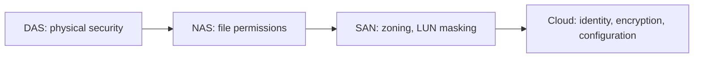

## Why should you care?

A company sells its old office laptops to a second-hand dealer after "formatting" the disks. A student buys one, runs a free recovery tool, and finds salary slips, customer lists and passwords.

Another company keeps all its files on a cloud storage bucket. An engineer sets it to "public" for a quick test and forgets. Months later, a security researcher finds lakhs of customer records open to the whole internet.

Neither case involved hacking a server. Data sitting **at rest**, on disks, file servers, backups and cloud buckets, is often protected less carefully than data moving across the network. Storage security fixes that.

## In one line

Storage security protects data at rest, on disks, storage networks, backups and cloud storage, through access control, encryption, isolation, backup and secure disposal, so that stored data stays confidential, intact and available.

## Explained

### Q1. What is storage security? ⭐

==Storage security is the set of controls that protect stored data and the storage systems that hold it from unauthorised access, change, loss and destruction.==

It covers data **at rest** on:

- ==**Local disks**== in PCs, laptops and phones.
- ==**Shared storage:**== file servers, NAS and SAN systems.
- ==**Removable media:**== pen drives, external disks, tapes.
- ==**Backups**== and archives.
- ==**Cloud storage:**== buckets, drives and cloud databases.

### Q2. How has storage evolved, and how did security change with it? ⭐

| Stage | Description | Security focus |
|---|---|---|
| ==DAS (Direct-Attached Storage)== | Disks inside or attached to one server | Physical security of the server |
| ==NAS (Network-Attached Storage)== | File server on the network, shared by many users | File permissions, network access |
| ==SAN (Storage Area Network)== | Dedicated high-speed network of storage for servers | Zoning, LUN masking, admin access |
| ==Cloud storage== | Storage rented from a provider over the internet | Configuration, identity, encryption, shared responsibility |

==As storage moved from one locked server to shared networks and the cloud, protection moved from physical locks to access control, encryption and correct configuration.==

### Q3. What are the main risks to stored data?

- ==**Unauthorised access:**== weak permissions, shared admin passwords, public cloud buckets.
- ==**Theft or loss of media:**== stolen laptops, lost pen drives and backup tapes.
- ==**Data leakage through disposal:**== old disks sold or thrown away without proper wiping.
- ==**Ransomware and malware:**== encrypting or destroying files and even connected backups.
- ==**Hardware failure and disasters:**== disk crashes, fire, flood.
- ==**Insider misuse:**== storage admins can see and copy everything.

### Q4. What is risk remediation for storage? ⭐

==Risk remediation means finding the weaknesses in storage and taking actions to remove or reduce them.==

1. ==**Classify data:**== know which data is sensitive and where it lives.
2. ==**Find exposures:**== review permissions, public shares, unencrypted disks, old media.
3. ==**Prioritise**== by risk ([[risk-analysis]]): sensitive data in exposed places first.
4. ==**Fix:**== restrict access, encrypt, isolate storage networks, delete unneeded copies.
5. ==**Verify and monitor:**== audit regularly and alert on unusual access.

### Q5. How is modern storage protected? (part 1)

- ==**Encryption at rest:**== full-disk encryption (BitLocker, phone storage), encrypted NAS volumes, cloud server-side encryption. Keys are kept separately in a key management system ([[symmetric-encryption]]).
- ==**Access control:**== least privilege on shares; separate storage admin accounts with MFA.
- ==**Storage network isolation:**== keep SAN and storage management on their own networks; use **zoning** (which servers may see which storage ports) and **LUN masking** (which servers may see which disks).
- ==**Cloud configuration:**== block public access by default; review bucket policies.

### Q6. How is modern storage protected? (part 2)

- ==**Backups and replication:**== follow the 3-2-1 rule; keep at least one copy offline or **immutable** (cannot be changed or deleted for a set period), so ransomware cannot reach it.
- ==**Integrity checks:**== checksums and snapshots detect and roll back unwanted changes.
- ==**Secure disposal:**== overwrite, cryptographically erase, or physically destroy media before reuse or disposal. A normal "format" does not remove data.
- ==**Monitoring and logging:**== record who accessed what; alert on mass reads or deletions.
- ==**Data minimisation:**== do not store what you do not need. The DPDP Act 2023 also expects personal data to be erased once its purpose is over.

### Q7. Differentiate between NAS and SAN. ⭐ [2M]

| Point | NAS | SAN |
|---|---|---|
| ==What it is== | A file server on the normal network | A separate high-speed network of storage |
| ==Access level== | Files (shared folders) | Blocks (appears as a local disk to servers) |
| ==Used by== | Users and small offices | Servers and databases in data centres |
| ==Key security controls== | File permissions, network access control | Zoning, LUN masking, isolated network |

### Q8. What are zoning and LUN masking? ⭐ [2M]

- ==**Zoning:** controls which servers can talk to which storage ports== on the SAN switch, like VLANs for storage.
- ==**LUN masking:** controls which servers can see which disks (LUNs)== on the storage system.

Together they ensure each server sees only its own storage.

### Q9. Why is a normal format not enough before disposing of a disk? [2M]

- ==**Format removes only the index**==; the data stays on the disk until overwritten.
- ==**Free recovery tools**== can read it back.
- ==**Proper sanitisation:**== overwrite the disk, use cryptographic erase, or physically destroy it.

> [!beyond] Beyond the syllabus
> In the cloud, security follows the **shared responsibility model**: the provider secures the physical disks and data centres, but the customer is responsible for who can access the data and how it is configured. Most cloud storage leaks are configuration mistakes by the customer.

## Analogy and real-life example

**Analogy: a bank's locker room.** Lockers are inside a strong room (physical security), each customer's key opens only their locker (access control), the bank keeps a register of every visit (logging), and old lockers are emptied and re-keyed before reuse (secure disposal). Storage security applies the same habits to data.

**Real example: the AIIMS ransomware attack, 2022.** The ransomware encrypted the primary and first backup servers because they were reachable from the infected network. Data was recovered from secondary servers that were not infected and were quickly disconnected. An offline or immutable backup is exactly the control that turns a disaster into an inconvenience.

## Diagram

## Key points

> [!important] Key points
> - Storage security protects data at rest: local disks, NAS/SAN, removable media, backups, cloud.
> - Evolution: DAS → NAS → SAN → cloud; focus moved from physical locks to access control, encryption and configuration.
> - Risks: unauthorised access, media theft, unsafe disposal, ransomware, hardware failure, insiders.
> - Risk remediation: classify data → find exposures → prioritise → fix → verify and monitor.
> - Protection: encryption at rest with separate key management, least privilege, network isolation (zoning, LUN masking), safe cloud configuration.
> - Also: 3-2-1 and immutable backups, integrity checks, secure disposal, monitoring, data minimisation.

## Common mistakes

> [!warning] Common mistake
> Thinking "format" or "delete" removes data. It only removes the index; the data stays until overwritten. Use proper sanitisation or physical destruction.

> [!warning] Common mistake
> Keeping the backup permanently connected to the same network and account. Ransomware that reaches the server will encrypt the backup too.

## Sources

- Mark Rhodes-Ousley, *Information Security: The Complete Reference*, 2nd ed., McGraw-Hill, chapter on storage security (verify).
- NIST Special Publication 800-209, *Security Guidelines for Storage Infrastructure*.
- NIST Special Publication 800-88 Revision 1, *Guidelines for Media Sanitization*.
