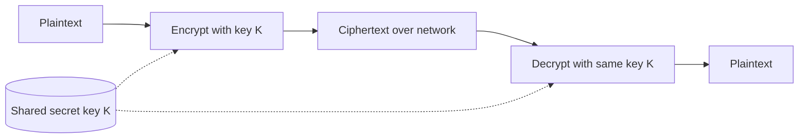

## Why should you care?

Your phone sends your WhatsApp messages, bank passwords and UPI PIN across networks you do not control: college Wi-Fi, mobile towers, internet exchanges. Anyone on the path could copy the data.

The only way to keep it secret on someone else's network is to scramble it so that only the intended receiver can unscramble it. That is encryption.

The fastest and most widely used kind is **symmetric encryption**. It protects your phone's storage, your Wi-Fi, every HTTPS page after the first handshake, and the backups of your bank. This lecture explains how it works and its one big problem.

## In one line

Symmetric encryption uses the same secret key to encrypt and decrypt data; it is fast, but the sender and receiver must share the key securely in advance.

## Explained

### Q1. What are the basic terms of cryptography?

| Term | Meaning |
|---|---|
| Plaintext | The original readable message |
| Ciphertext | The scrambled, unreadable output |
| Encryption | Converting plaintext to ciphertext |
| Decryption | Converting ciphertext back to plaintext |
| Algorithm (cipher) | The mathematical method used |
| Key | The secret value that controls the algorithm |

==The algorithm can be public; the security depends only on keeping the key secret.== This is known as **Kerckhoffs's principle**.

### Q2. What is symmetric encryption? ⭐

==Symmetric (secret-key) encryption uses one shared key for both encryption and decryption.==

$$C = E_K(P) \qquad P = D_K(C)$$

- $P$ = plaintext, $C$ = ciphertext, $K$ = the shared key, $E$ = encrypt, $D$ = decrypt.

**Simple example (Caesar cipher, key = 3):** shift each letter 3 places.
`HELLO` → `KHOOR`. The receiver shifts back 3 to read it.

Real ciphers are far stronger, but the idea is the same: one key, used on both sides.

### Q3. What are block and stream ciphers?

- ==**Block cipher:** encrypts fixed-size blocks== of data (for example 128 bits at a time). Examples: DES, 3DES, AES.
- ==**Stream cipher:** encrypts one bit or byte at a time==, mixing the data with a key stream. Example: ChaCha20 (used in mobile HTTPS).
- Block ciphers use a **mode of operation** to handle long messages:
  - ==**ECB:** each block encrypted separately==; equal blocks give equal ciphertext, so patterns leak. Avoid.
  - ==**CBC, GCM:** each block depends on the previous one== or on a counter; patterns are hidden. GCM also checks integrity.

### Q4. What are the common symmetric algorithms? ⭐

| Algorithm | Key size | Block size | Status |
|---|---|---|---|
| ==DES== | 56 bits | 64 bits | Broken by brute force (1990s); do not use |
| ==3DES== | 112 or 168 bits | 64 bits | Slow; retired by NIST |
| ==AES== | 128, 192 or 256 bits | 128 bits | Current standard; used everywhere |

==AES (Advanced Encryption Standard), standardised by NIST in 2001, is today's standard symmetric cipher.== AES-128 is already far beyond brute-force reach; AES-256 is used for extra safety.

### Q5. What are the advantages of symmetric encryption?

- ==**Fast:**== much faster than public-key encryption; modern CPUs have built-in AES instructions.
- ==**Efficient for large data:**== disks, databases, video, backups.
- ==**Short keys give strong security:**== a 128-bit key is enough.
- ==**Simple to implement**== in hardware such as Wi-Fi chips and smart cards.

Where it is used: Wi-Fi (WPA2/WPA3), full-disk encryption (BitLocker, phone storage), VPN tunnels, HTTPS data after the handshake, encrypted database columns.

### Q6. What is the key distribution problem? ⭐

==The key distribution problem is that both parties must share the same secret key safely before they can communicate securely.==

- If you send the key over the same network, an attacker can copy it.
- ==**Number of keys grows fast:**== $n$ users need $\frac{n(n-1)}{2}$ keys for every pair to talk privately. For 100 users that is 4,950 keys.
- ==**No non-repudiation:**== both sides hold the same key, so either could have created a message.

==The solution in practice is public-key cryptography to exchange the symmetric key, then symmetric encryption for the data== ([[public-key-encryption]]).

> [!beyond] Beyond the syllabus
> Large quantum computers would weaken symmetric ciphers only moderately (roughly halving effective key length), which is one reason AES-256 is recommended for long-term secrets. Public-key algorithms are far more affected.

## Analogy and real-life example

**Analogy: a locker with one key and its duplicate.** You and your friend each hold a copy of the same key to a shared locker. Either of you can put things in and take them out. It works well, but first you had to hand over the duplicate key in person. If you posted it, the postman could have made his own copy.

**Real example: your phone's storage.** Modern Android and iPhone devices encrypt all data with AES. The key is locked inside the phone's security chip and unlocked by your PIN or fingerprint. If the phone is stolen and the chip is read directly, the attacker sees only ciphertext.

## Diagram

## Key points

> [!important] Key points
> - Plaintext → (encrypt with key) → ciphertext → (decrypt with key) → plaintext.
> - Kerckhoffs's principle: the algorithm may be public; only the key must be secret.
> - Symmetric encryption: one shared key for both encryption and decryption.
> - Block ciphers (DES, 3DES, AES) vs stream ciphers (ChaCha20). Avoid ECB mode.
> - DES: 56-bit key, broken. 3DES: retired. AES: 128/192/256-bit keys, 128-bit block, current standard.
> - Advantages: fast, efficient for bulk data, short keys.
> - Key distribution problem: key must be shared securely; n users need n(n−1)/2 keys; no non-repudiation.

## Common mistakes

> [!warning] Common mistake
> Thinking a secret algorithm makes encryption stronger. Secret, home-made ciphers are usually weak; trusted ciphers like AES are public and have been tested by experts for years.

> [!warning] Common mistake
> Writing the key count as $n^2$. Each pair needs one key, so it is $n(n-1)/2$.

## Exam questions

**Short answer (2–3 marks)**
1. Define plaintext, ciphertext and key.
2. What is symmetric encryption? Give two examples of algorithms. ⭐
3. Differentiate between block and stream ciphers. ⭐
4. How many keys are needed for 50 users to communicate privately using symmetric encryption?

**Long answer (5 marks)**
1. Explain symmetric encryption with a diagram, its advantages and its limitations. ⭐
2. Compare DES, 3DES and AES.
3. What is the key distribution problem? How is it solved in practice? ⭐

## Sources

- William Stallings, *Cryptography and Network Security*, Pearson, chapters on classical encryption techniques, block ciphers and DES, and AES (verify).
- Mark Rhodes-Ousley, *Information Security: The Complete Reference*, 2nd ed., McGraw-Hill, chapter on encryption (verify).
- NIST FIPS 197, *Advanced Encryption Standard (AES)*.
