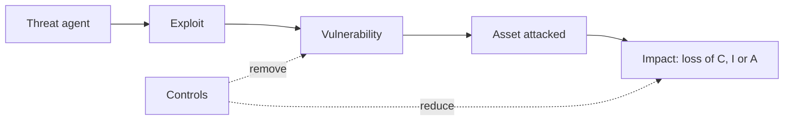

## Why should you care?

You get an SMS: "Dear customer, your electricity connection will be cut tonight. Update your details at this link." You click, enter your bank details, and ₹40,000 disappears.

Nobody broke any encryption. The attacker used a **threat** (a fraudster), found a **vulnerability** (a worried customer who trusts SMS links), and carried out an **attack** (phishing).

Before you can defend anything, you must name what you are defending against. Security professionals use exact words for this, and every later topic in this subject, from risk analysis to firewalls, uses them.

## In one line

A threat is anything that can cause harm, a vulnerability is a weakness it can use, and an attack is the actual attempt to exploit that weakness.

## Explained

### Q1. What are threat, vulnerability, attack and risk?

| Term | Meaning | Example |
|---|---|---|
| Asset | Anything of value | Student database |
| Threat | A possible cause of harm | A hacker, a flood, a careless clerk |
| Vulnerability | A weakness that can be used | Default admin password on the ERP |
| Exploit | The method or tool that uses a weakness | A script that logs in with default passwords |
| Attack | An actual attempt to cause harm | The hacker logs in and changes marks |
| Risk | Chance of harm × its impact | High: easy to do, serious result |

==A threat exploits a vulnerability to harm an asset; a control removes the vulnerability or reduces the harm.==

### Q2. Where do threats come from?

- **By source:**
  - **External:** hackers, criminal gangs, competitors, nation-state groups.
  - **Internal (insiders):** employees, contractors, ex-employees with old access. Insiders already know the systems, so they are often the most damaging.
- **By intent:**
  - **Intentional:** theft, fraud, sabotage.
  - **Accidental:** wrong file deleted, data emailed to the wrong person.
- **Natural and environmental:** flood, fire, earthquake, power failure.

A complete security plan covers all three kinds, not just hackers.

### Q3. What are passive attacks?

==A passive attack only observes or copies information; it does not change anything.==

- **Release of message contents:** reading emails or captured network traffic.
- **Traffic analysis:** studying who talks to whom, how often and how much, even if the content is encrypted.

Passive attacks are hard to **detect** because nothing changes. The defence is to **prevent** them, mainly with encryption.

### Q4. What are active attacks?

An active attack changes data or disrupts a system.

| Attack | What happens |
|---|---|
| Masquerade | Attacker pretends to be someone else (stolen password) |
| Replay | Captured valid data is sent again later (re-sending a payment request) |
| Modification | Data is changed in transit (account number altered) |
| Denial of service (DoS) | A system is flooded or crashed so real users cannot use it |

Active attacks are easier to detect but hard to prevent completely. The aim is to detect them quickly and recover.

### Q5. What are the common attacks today? (part 1)

- **Malware:** harmful software.
  - Virus (attaches to files), worm (spreads by itself), Trojan (hides inside useful-looking software), spyware, and **ransomware** (encrypts data and demands payment).
- **Phishing and social engineering:** tricking people into giving passwords, OTPs or money. Fake KYC SMS, fake customer-care numbers and calls from "bank officers" are common in India.
- **Password attacks:** guessing, brute force, and reusing passwords leaked from other sites (credential stuffing).

### Q6. What are the common attacks today? (part 2)

- **DoS and DDoS:** a distributed DoS uses thousands of infected devices (a botnet) to flood a website.
- **Man-in-the-middle (MITM):** the attacker sits between two parties, for example on fake public Wi-Fi, and reads or changes their traffic.
- **Injection attacks:** malicious input such as SQL injection makes a web application run the attacker's commands (Unit 4).
- **Insider misuse:** a staff member copies customer data before leaving.
- **Exploiting unpatched software:** using a known bug that the organisation has not fixed.

> [!beyond] Beyond the syllabus
> Security teams map real attacks step by step using the MITRE ATT&CK framework, a public catalogue of attacker techniques, from first access to stealing data.

## Analogy and real-life example

**Analogy: a house.** The threat is a burglar. The vulnerability is a broken window latch. The attack is the burglar climbing in through that window. The risk is how likely that is and how much he could take. You cannot remove burglars from the world, so you fix the latch (remove the vulnerability), add an alarm (detect), and insure the valuables (reduce the impact).

**Real example: the AIIMS ransomware attack, 2022.** Threat: a criminal ransomware group. Vulnerability: a weakness in the hospital's systems that let the malware in and spread. Attack: ransomware encrypted the e-Hospital servers. Impact: hospital services ran on paper for more than a week.

## Diagram

## Key points

> [!important] Key points
> - Asset: something of value. Threat: possible cause of harm. Vulnerability: weakness. Exploit: method that uses the weakness. Attack: actual attempt. Risk: likelihood × impact.
> - Threat sources: external or internal; intentional or accidental; natural or environmental.
> - Passive attacks observe only (release of message contents, traffic analysis); prevent them with encryption.
> - Active attacks change or disrupt (masquerade, replay, modification, DoS); detect and recover.
> - Common attacks: malware (virus, worm, Trojan, spyware, ransomware), phishing and social engineering, password attacks, DoS/DDoS, MITM, injection, insider misuse, unpatched software.

## Common mistakes

> [!warning] Common mistake
> Using "threat" and "vulnerability" as the same word. A threat comes from outside the weakness (a person or event); a vulnerability is the weakness itself. You can remove a vulnerability; you usually cannot remove a threat.

> [!warning] Common mistake
> Thinking encryption stops all passive attacks. It hides the content, but traffic analysis can still reveal who talks to whom and when.

## Exam questions

**Short answer (2–3 marks)**
1. Differentiate between a threat and a vulnerability, with an example.
2. What is a passive attack? Give two types.
3. Define masquerade and replay attacks.
4. What is ransomware?

**Long answer (5 marks)**
1. Explain the relationship between asset, threat, vulnerability, attack and risk with a diagram.
2. Compare passive and active attacks, with types and examples of each.
3. Describe any five common attacks faced by organisations today.

## Sources

- Mark Rhodes-Ousley, *Information Security: The Complete Reference*, 2nd ed., McGraw-Hill, Ch. 2 (verify).
- William Stallings, *Cryptography and Network Security*, Pearson, Ch. 1, "Security Attacks" (verify).
- Charles P. Pfleeger, Shari L. Pfleeger and Jonathan Margulies, *Security in Computing*, 5th ed., Pearson, Ch. 1 (verify).
