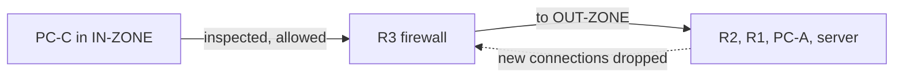

## Aim

To configure a Zone-Based Policy Firewall on a Cisco router so that hosts in the inside zone can start connections to the outside, while connections started from the outside into the inside zone are blocked.

## Concepts used

- [[zones-of-trust]]: interfaces grouped by trust level.
- [[defense-models]]: a firewall as one layer of defense in depth.
- [[firewalls]]: stateful inspection (Unit 3 theory).

**Why this matters.** An ACL checks each packet on its own and has no memory of conversations. To let inside users browse while blocking outsiders, you would need many careful ACL lines. A **stateful** firewall remembers the connections inside users start and lets only their replies back in. The Zone-Based Policy Firewall turns a Cisco router into such a firewall, using the zones-of-trust idea directly.

## Setup

**Tool:** Cisco Packet Tracer (8.x or later).

### Devices and topology

Open your saved file from **Practical 4**. The firewall is configured on **R3**:

| Zone | R3 interface | Contains |
|---|---|---|
| IN-ZONE | G0/0 | PC-C's LAN (192.168.3.0/24) |
| OUT-ZONE | G0/1 | Link to R2 and everything beyond |



### Security license

Zone-based firewall needs the **security** technology package on the 2911. Packet Tracer lets you enable it with a command and a reload (Step 1).

## Code

### Step 1. Enable the security license on R3

```text
R3# configure terminal
R3(config)# license boot module c2900 technology-package securityk9
ACCEPT? [yes/no]: yes
R3(config)# end
R3# copy running-config startup-config
R3# reload
R3# show version
```

### Step 2. Create the zones

```text
R3(config)# zone security IN-ZONE
R3(config-sec-zone)# exit
R3(config)# zone security OUT-ZONE
R3(config-sec-zone)# exit
```

### Step 3. Class map: which traffic to inspect

```text
R3(config)# access-list 101 permit ip 192.168.3.0 0.0.0.255 any
R3(config)# class-map type inspect match-all IN-NET-CLASS-MAP
R3(config-cmap)# match access-group 101
R3(config-cmap)# exit
```

### Step 4. Policy map: what to do with it

```text
R3(config)# policy-map type inspect IN-2-OUT-PMAP
R3(config-pmap)# class type inspect IN-NET-CLASS-MAP
R3(config-pmap-c)# inspect
R3(config-pmap-c)# exit
R3(config-pmap)# exit
```

### Step 5. Zone pair and service policy

```text
R3(config)# zone-pair security IN-2-OUT-ZPAIR source IN-ZONE destination OUT-ZONE
R3(config-sec-zone-pair)# service-policy type inspect IN-2-OUT-PMAP
R3(config-sec-zone-pair)# exit
```

### Step 6. Put the interfaces into zones

```text
R3(config)# interface g0/0
R3(config-if)# zone-member security IN-ZONE
R3(config-if)# interface g0/1
R3(config-if)# zone-member security OUT-ZONE
R3(config-if)# end
R3# copy running-config startup-config
```

### Step 7. Verify

```text
PC-C> ping 192.168.1.3
PC-C: Web Browser → http://192.168.1.5   (keep it open)
R3# show policy-map type inspect zone-pair sessions
PC-A> ping 192.168.3.3
R1# ssh -l SSHadmin 10.2.2.1
```

## Output

> [!warning] Replace with your own output
> The blocks below show what correct output looks like. After running the lab, paste your real output here, or save a screenshot in `content/assets/img/security-in-computing/` and link it with alt text.

**Test results**

| Test | Result |
|---|---|
| PC-C `ping 192.168.1.3` | Replies (started inside, inspected) |
| PC-C browser `http://192.168.1.5` | Page loads |
| PC-A `ping 192.168.3.3` | Request timed out (started outside) |
| R1 `ssh -l SSHadmin 10.2.2.1` | Login prompt (traffic to the router itself, not to IN-ZONE) |

**Active inspected session** (`show policy-map type inspect zone-pair sessions`, excerpt):

```output
Zone-pair: IN-2-OUT-ZPAIR
  Service-policy inspect : IN-2-OUT-PMAP
    Class-map: IN-NET-CLASS-MAP (match-all)
      Match: access-group 101
      Inspect
        Established Sessions
         Session ... (192.168.3.3:1025)=>(192.168.1.5:80) http SIS_OPEN
```

## Explanation

### The four building blocks of ZPF

| Block | Command | Answers |
|---|---|---|
| Zone | `zone security` | Which interfaces share a trust level? |
| Class map | `class-map type inspect` | Which traffic? |
| Policy map | `policy-map type inspect` | What action: `inspect`, `pass` or `drop`? |
| Zone pair | `zone-pair security … source … destination` | In which direction does the policy apply? |

==A zone-based firewall applies policies to traffic between zones, not to individual interfaces.==

### What `inspect` does

- ==`inspect` makes the firewall stateful==: it records each connection PC-C starts (addresses, ports, state).
- Replies that match a recorded session are allowed back automatically; no return rule is needed.
- `pass` allows traffic in one direction only, without state; `drop` discards it.

### Default behaviour

- ==Traffic between two different zones is dropped unless a zone pair and policy allow it.== That is why PC-A cannot start a ping to PC-C.
- Traffic between interfaces in the **same** zone flows freely.
- Traffic to and from the router itself belongs to the built-in **self zone**, which is allowed by default. That is why SSH and OSPF to R3 still work.

> [!beyond] Beyond the syllabus
> Dedicated next-generation firewalls add application awareness (identifying WhatsApp or YouTube regardless of port), user identity and intrusion prevention in the same box. You will meet Cisco's dedicated firewall, the ASA, in Unit 4 practicals.

## Try it

Create a second zone pair **OUT-2-IN** that allows only ping from OUT-ZONE to IN-ZONE (use an ACL matching ICMP and the `inspect` action). Can PC-A now ping PC-C? Can it open a web page on PC-C's network?

## Viva questions

1. What is a zone-based policy firewall? *A Cisco IOS firewall that groups interfaces into zones and applies inspection policies to traffic between zones.*
2. What is the default action for traffic between two zones? *Drop, unless a zone pair with a policy allows it.*
3. What is the difference between `inspect`, `pass` and `drop`? *Inspect allows and tracks connections statefully; pass allows one direction without state; drop discards.*
4. What is the self zone? *A built-in zone for traffic to and from the router itself; allowed by default.*
5. Why is a stateful firewall better than an ACL for this job? *It remembers connections started inside and allows only their replies back, without needing return rules.*
6. Why was the security license needed? *ZPF is part of the security technology package on ISR G2 routers.*

## Sources

- Cisco, *Security Configuration Guide: Zone-Based Policy Firewall* for IOS (verify exact title for your IOS version).
- Cisco Networking Academy, CCNA Security Packet Tracer activity: Configuring a Zone-Based Policy Firewall (ZPF) (verify).
