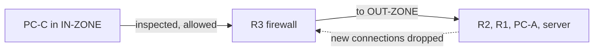

## Aim

To configure a Zone-Based Policy Firewall on a Cisco router so that hosts in the inside zone can start connections to the outside, while connections started from the outside into the inside zone are blocked.

## Concepts used

- [[zones-of-trust]]: interfaces grouped by trust level.
- [[defense-models]]: a firewall as one layer of defense in depth.
- [[firewalls]]: stateful inspection (Unit 3 theory).

**Why this matters.** An ACL checks each packet on its own and has no memory of conversations. To let inside users browse while blocking outsiders, you would need many careful ACL lines. A **stateful** firewall remembers the connections inside users start and lets only their replies back in. The Zone-Based Policy Firewall turns a Cisco router into such a firewall, using the zones-of-trust idea directly.

## Before the lab

**Install or open**
- Cisco Packet Tracer 8.x or later.
- Your saved file **practical4.pkt** (no ACLs yet). Do **not** start from Practical 5 or 6.
- R3's SSH login: **SSHadmin / ciscosshpa55**. R1's console login: **Admin1 / admin1pa55**.

**Revise first**
- [[zones-of-trust]]: inside, outside, and the rule that lower trust may not start connections to higher trust.
- ACL syntax from [[extended-numbered-acl-practical]]: an ACL is used here to pick the traffic.
- Stateless versus stateful: an ACL looks at one packet; a stateful firewall remembers the whole conversation.

## Setup

**Tool:** Cisco Packet Tracer (8.x or later).

### Devices and topology

The Practical 4 topology. The firewall is configured on **R3**:

| Zone | R3 interface | Contains |
|---|---|---|
| IN-ZONE | G0/0 | PC-C's LAN (192.168.3.0/24) |
| OUT-ZONE | G0/1 | Link to R2 and everything beyond |



### Security license

Zone-based firewall needs the **security** technology package on the 2911. Packet Tracer lets you enable it with a command and a reload (Steps 3–5).

## Steps

### Part A. Baseline and licence

1. **Open your Practical 4 file and save a copy** as `practical7.pkt`.
   → **You should see:** the Practical 4 topology, all links green.
2. **Confirm that the outside can reach the inside now.** PC-A: `ping 192.168.3.3`.
   → **You should see:** replies. After the firewall this must fail.
3. **Enable the security licence on R3.**
   ```text
   configure terminal
   license boot module c2900 technology-package securityk9
   ```
   At `ACCEPT? [yes/no]:`, type `yes`.
   → **You should see:** a licence notice, then `% use 'write' command to make license boot config take effect on next boot`.
4. **Save and reload R3.**
   ```text
   end
   copy running-config startup-config
   reload
   ```
   Press Enter at `Proceed with reload? [confirm]`.
   → **You should see:** R3 restart and boot messages scroll; the prompt returns as `R3>`.
5. **Check the licence.** `show version`
   → **You should see:** in the Technology Package table, the `security` row shows `securityk9`.

### Part B. Build the firewall policy

6. **Create the two zones.**
   ```text
   enable
   configure terminal
   zone security IN-ZONE
   exit
   zone security OUT-ZONE
   exit
   ```
   → **You should see:** the prompt `R3(config-sec-zone)#` while inside each zone, then `R3(config)#`.
7. **Choose the traffic: an ACL and a class map.**
   ```text
   access-list 101 permit ip 192.168.3.0 0.0.0.255 any
   class-map type inspect match-all IN-NET-CLASS-MAP
    match access-group 101
   exit
   ```
   → **You should see:** the prompt `R3(config-cmap)#`, then `R3(config)#`.
8. **Choose the action: a policy map that inspects that class.**
   ```text
   policy-map type inspect IN-2-OUT-PMAP
    class type inspect IN-NET-CLASS-MAP
     inspect
    exit
   exit
   ```
   → **You should see:** the prompts `R3(config-pmap)#` and `R3(config-pmap-c)#`, then `R3(config)#`.
9. **Choose the direction: a zone pair from inside to outside, with the policy attached.**
   ```text
   zone-pair security IN-2-OUT-ZPAIR source IN-ZONE destination OUT-ZONE
    service-policy type inspect IN-2-OUT-PMAP
   exit
   ```
   → **You should see:** the prompt `R3(config-sec-zone-pair)#`, then `R3(config)#`.

### Part C. Put the interfaces into zones

10. **Put the LAN interface into IN-ZONE.**
    ```text
    interface g0/0
     zone-member security IN-ZONE
    ```
    → **You should see:** no message. For a moment PC-C loses connectivity, because traffic between a zoned and an unzoned interface is dropped. Step 11 fixes this.
11. **Put the WAN interface into OUT-ZONE.**
    ```text
    interface g0/1
     zone-member security OUT-ZONE
    end
    ```
    → **You should see:** the prompt return to `R3#`.

### Part D. Test

12. **Inside to outside.** PC-C: `ping 192.168.1.3`.
    → **You should see:** replies (started inside, inspected, replies allowed back).
13. **Inside to outside, web.** PC-C → Web Browser → `http://192.168.1.5`. Keep it open and, on R3, run `show policy-map type inspect zone-pair sessions`.
    → **You should see:** the page loads, and an established session from 192.168.3.3 to 192.168.1.5 port 80.
14. **Outside to inside.** PC-A: `ping 192.168.3.3`.
    → **You should see:** `Request timed out.` four times.
15. **Traffic to the router itself.** On R1 (after logging in), `ssh -l SSHadmin 10.2.2.1`.
    → **You should see:** `Password:` and then `R3>`. Traffic to the router itself is not blocked.
16. **Save everything.** `copy running-config startup-config` on R3; File → Save.
    → **You should see:** `Building configuration... [OK]`.

## Code

Complete configuration added on **R3** in this practical:

```text
license boot module c2900 technology-package securityk9
! (accept, save and reload)
zone security IN-ZONE
zone security OUT-ZONE
access-list 101 permit ip 192.168.3.0 0.0.0.255 any
class-map type inspect match-all IN-NET-CLASS-MAP
 match access-group 101
policy-map type inspect IN-2-OUT-PMAP
 class type inspect IN-NET-CLASS-MAP
  inspect
zone-pair security IN-2-OUT-ZPAIR source IN-ZONE destination OUT-ZONE
 service-policy type inspect IN-2-OUT-PMAP
interface g0/0
 zone-member security IN-ZONE
interface g0/1
 zone-member security OUT-ZONE
```

## Output

> [!warning] Replace with your own output
> The blocks below show what correct output looks like. After running the lab, paste your real output here, or save a screenshot in `content/assets/img/security-in-computing/` and link it with alt text.

**Test results**

| Test | Result |
|---|---|
| PC-C `ping 192.168.1.3` | Replies (started inside, inspected) |
| PC-C browser `http://192.168.1.5` | Page loads |
| PC-A `ping 192.168.3.3` | Request timed out (started outside) |
| R1 `ssh -l SSHadmin 10.2.2.1` | Login prompt (traffic to the router itself, not to IN-ZONE) |

**Active inspected session** (`show policy-map type inspect zone-pair sessions`, excerpt):

```output
Zone-pair: IN-2-OUT-ZPAIR
  Service-policy inspect : IN-2-OUT-PMAP
    Class-map: IN-NET-CLASS-MAP (match-all)
      Match: access-group 101
      Inspect
        Established Sessions
         Session ... (192.168.3.3:1025)=>(192.168.1.5:80) http SIS_OPEN
```

## Explanation

### The four building blocks of ZPF

| Block | Command | Answers |
|---|---|---|
| Zone | `zone security` | Which interfaces share a trust level? |
| Class map | `class-map type inspect` | Which traffic? |
| Policy map | `policy-map type inspect` | What action: `inspect`, `pass` or `drop`? |
| Zone pair | `zone-pair security … source … destination` | In which direction does the policy apply? |

==A zone-based firewall applies policies to traffic between zones, not to individual interfaces.==

### What `inspect` does

- ==`inspect` makes the firewall stateful==: it records each connection PC-C starts (addresses, ports, state).
- Replies that match a recorded session are allowed back automatically; no return rule is needed.
- `pass` allows traffic in one direction only, without state; `drop` discards it.

### Default behaviour

- ==Traffic between two different zones is dropped unless a zone pair and policy allow it.== That is why PC-A cannot start a ping to PC-C.
- Traffic between interfaces in the **same** zone flows freely.
- Traffic to and from the router itself belongs to the built-in **self zone**, which is allowed by default. That is why SSH and OSPF to R3 still work.

> [!beyond] Beyond the syllabus
> Dedicated next-generation firewalls add application awareness (identifying WhatsApp or YouTube regardless of port), user identity and intrusion prevention in the same box. You will meet Cisco's dedicated firewall, the ASA, in Unit 4 practicals.

## Common errors and fixes

| Message or symptom | Cause | Fix |
|---|---|---|
| `% Invalid input detected at '^' marker.` on `zone security IN-ZONE` | The security licence is not active yet | Do Steps 3–5; the licence works only **after** the reload. Check `show version` |
| After the reload, R3 has lost its configuration | The configuration was not saved before `reload` | R3 boots from the startup configuration. Always `copy running-config startup-config` before reloading |
| PC-C cannot reach anything after Step 10 | Only one interface is in a zone; traffic between zoned and unzoned interfaces is dropped | Do Step 11. Check `show zone security` lists G0/0 in IN-ZONE and G0/1 in OUT-ZONE |
| PC-C still cannot reach the outside after Step 11 | The zone pair was written in the wrong direction, the policy is not attached, or ACL 101 has the wrong network | `show zone-pair security` must show source IN-ZONE, destination OUT-ZONE and policy IN-2-OUT-PMAP. Check `show access-lists 101` |
| Error when typing `class type inspect IN-NET-CLASS-MAP` | No class map exists with exactly that name | Names are case-sensitive and must match. Check `show class-map type inspect` |
| PC-A can still ping PC-C | Zones not applied, or an OUT-2-IN zone pair exists | Check `show zone security` and `show zone-pair security` |

## Try it

Create a second zone pair **OUT-2-IN** that allows only ping from OUT-ZONE to IN-ZONE (use an ACL matching ICMP and the `inspect` action). Can PC-A now ping PC-C? Can it open a web page on PC-C's network?

## Viva questions

1. What is a zone-based policy firewall? *A Cisco IOS firewall that groups interfaces into zones and applies inspection policies to traffic between zones.*
2. What is the default action for traffic between two zones? *Drop, unless a zone pair with a policy allows it.*
3. What is the difference between `inspect`, `pass` and `drop`? *Inspect allows and tracks connections statefully; pass allows one direction without state; drop discards.*
4. What is the self zone? *A built-in zone for traffic to and from the router itself; allowed by default.*
5. Why is a stateful firewall better than an ACL for this job? *It remembers connections started inside and allows only their replies back, without needing return rules.*
6. Why was the security license needed? *ZPF is part of the security technology package on ISR G2 routers.*

## Sources

- Cisco, *Security Configuration Guide: Zone-Based Policy Firewall* for IOS (verify exact title for your IOS version).
- Cisco Networking Academy, CCNA Security Packet Tracer activity: Configuring a Zone-Based Policy Firewall (ZPF) (verify).
