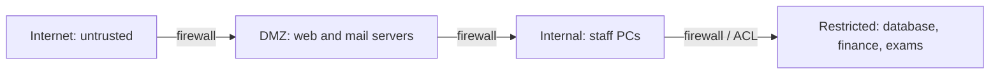

## Why should you care?

In most colleges, the student lab, the staff room, the accounts office, the CCTV cameras, the public Wi-Fi and the exam server are all on **one flat network**. Any device can reach any other.

So a virus brought in on a student's pen drive can reach the accounts PC. A visitor on guest Wi-Fi can try to log in to the exam server.

These devices do not deserve the same trust. A visitor's phone is not the principal's laptop. Zones of trust group systems by how much they can be trusted and control what crosses between groups. It is how the onion model of [[defense-models]] is actually built inside a network.

## In one line

Zones of trust divide a network into segments with different trust levels, and control and inspect all traffic that moves between them, so that a less-trusted zone cannot freely reach a more-trusted one.

## Explained

### Q1. What is a zone of trust?

==A zone of trust is a group of systems that share the same level of trust and the same security requirements, separated from other zones by controlled boundaries.==

- Systems inside a zone can talk to each other more freely.
- Traffic between zones must pass a **control point**, usually a firewall or router with access rules.
- Each zone gets controls that match the value of what it holds.

### Q2. What are the common zones?

| Zone | Trust level | Example systems |
|---|---|---|
| Internet / untrusted | None | Everyone outside the organisation |
| Guest | Very low | Visitor Wi-Fi |
| DMZ (demilitarised zone) | Low | Public website, mail server |
| Internal / trusted | Medium | Staff PCs, printers, internal apps |
| Restricted / high security | High | Database servers, finance, exam server, HR records |
| Management | High | Network admin access to routers and firewalls |

The more valuable the data, the deeper (more trusted, more protected) the zone.

### Q3. What is a DMZ?

==A DMZ is a separate zone between the internet and the internal network that holds servers the public must reach, such as a website.==

- Internet users may reach the DMZ, but **not** the internal network.
- DMZ servers may reach only the specific internal services they need.
- If a DMZ web server is hacked, the attacker is still outside the internal zone.

You will configure a real DMZ on the Cisco ASA in practical 14.

### Q4. How is traffic between zones controlled?

The basic rule:

- **Higher trust to lower trust:** usually allowed (staff browsing the internet), with replies allowed back.
- **Lower trust to higher trust:** blocked by default; allowed only for specific, needed services.

Boundaries are enforced with:
- firewalls and access control lists (ACLs),
- VLANs and network segmentation,
- VPNs for remote users entering a zone,
- monitoring (IDS) at the boundary.

You will build these in practicals 5–7 (ACLs, zone-based firewall) and 10 (VLAN security).

### Q5. Why use zones of trust?

- **Contain attacks:** malware in the student lab cannot spread to finance.
- **Apply the right controls:** strict rules where data is valuable, lighter rules elsewhere.
- **Reduce the attack surface:** each system is reachable only by those who need it.
- **Easier monitoring:** traffic crossing a boundary is a natural place to log and inspect.
- **Supports compliance:** standards such as PCI DSS expect sensitive systems to be segmented.

### Q6. What are the challenges?

- **Design effort:** each system must be classified and placed correctly.
- **Too many exceptions:** every "temporary" rule that opens a zone weakens it.
- **Trust inside a zone:** an attacker inside a zone can still reach its neighbours.
- **Mobile and cloud users** do not sit neatly inside one zone.

==Zones of trust work only if the rules between zones are kept strict and reviewed regularly.==

> [!beyond] Beyond the syllabus
> **Micro-segmentation** in data centres and clouds shrinks zones down to single applications or even single servers, each with its own rules. Together with identity checks on every request, this is the basis of zero trust networks.

## Analogy and real-life example

**Analogy: an airport.** The public area (anyone can enter) is the internet. The check-in hall (with tickets) is the DMZ. The area after security check is the internal zone. The cockpit and air traffic control are restricted zones. You cross each boundary only through a checkpoint, and each checkpoint is stricter than the last.

**Real example: a bank branch network.** ATMs, the public website, staff PCs and the core banking servers are kept in separate zones. The website in the DMZ cannot talk directly to core banking; it must go through specific, tightly controlled services. Even if the website is attacked, account balances stay out of reach.

## Diagram

## Key points

> [!important] Key points
> - Zone of trust: a group of systems with the same trust level and security needs, separated from others by controlled boundaries.
> - Common zones: internet (untrusted), guest, DMZ, internal, restricted, management.
> - DMZ: zone between internet and internal network for public-facing servers.
> - Rule: lower-trust to higher-trust traffic is blocked by default; only needed services are allowed.
> - Boundaries enforced with firewalls, ACLs, VLANs, VPNs and monitoring.
> - Benefits: contain attacks, match controls to value, smaller attack surface, easier monitoring, compliance.

## Common mistakes

> [!warning] Common mistake
> Putting the public web server inside the internal network "because it is ours". A public server is the most attacked machine; it belongs in the DMZ.

> [!warning] Common mistake
> Thinking a VLAN alone makes a secure zone. A VLAN separates traffic, but without ACLs or a firewall between VLANs, routing can still connect them.

## Exam questions

**Short answer (2–3 marks)**
1. What is a zone of trust?
2. What is a DMZ? Why is it used?
3. Name any four zones of trust found in an organisation.
4. How is traffic between zones controlled?

**Long answer (5 marks)**
1. Explain zones of trust with a diagram of a typical organisation.
2. Explain the benefits and challenges of dividing a network into zones of trust.
3. Design zones of trust for a college network (labs, staff, accounts, exam server, guest Wi-Fi, website), and state the rules between them.

## Sources

- Mark Rhodes-Ousley, *Information Security: The Complete Reference*, 2nd ed., McGraw-Hill, Ch. 4, "Secure Design Principles": zones of trust (verify).
- NIST Special Publication 800-41 Revision 1, *Guidelines on Firewalls and Firewall Policy*.
