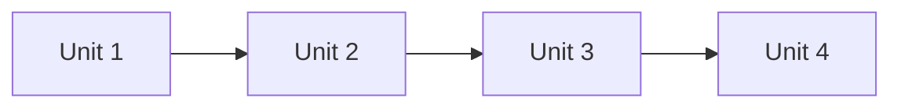

<!-- Read first; opens the first lecture of the subject. Short and motivating.
     Each section under about 120 words. All sections required. -->

## Why this subject matters

<!-- A real problem this subject solves, Indian context where natural. -->

## A short story

<!-- History, or a recent event, that shows the subject in action. -->

## Where it is used today

## What you will be able to do

<!-- What students can do after this course, in plain words. -->

## Careers that use it

## Map of the subject

## Sources

- 
